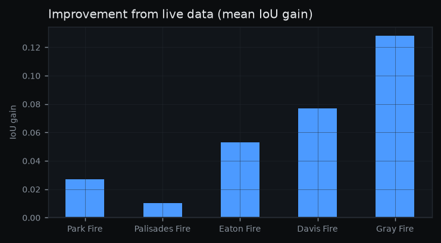

# FIREWATCH

**A wildfire common operating picture. It assimilates satellite and camera observations into a
calibrated spread forecast and turns that forecast into evacuation, egress, and staging
recommendations that a person approves.**



Detecting a wildfire is a solved input. Knowing where it will be in three hours, how sure you can
be, and which town to move first is the hard part. Physics-based forecasters can correct
themselves from observations, but they live inside HPC-scale coupled simulators. Open ML models
are accessible, but they are single-shot, next-day, uncalibrated, and stop at a map. FIREWATCH
sits between the two: a transparent physical ensemble on a single machine, corrected by every new
satellite or camera observation, scored for calibration, and wrapped in a decision layer that
cites its evidence.

Live instrument: **https://keshavkrishnan08.github.io/firewatch/**

```
public feeds (GOES-18, FIRMS VIIRS/MODIS, HRRR/NWS wind, terrain, fuels, NIFC perimeters, OSM)
    ->  time-versioned ontology (DuckDB; every object has provenance and a valid time)
    ->  camera smoke -> georeferenced fire front with an uncertainty region
    ->  Rothermel + minimum-travel-time ensemble (perturbed wind, moisture, ignition, ROS)
    ->  particle-filter assimilation of hotspots, camera fronts, and perimeters
    ->  calibrated burn probability at each horizon, with a 90% credible region
    ->  ranked evacuations, threatened egress roads, staging points, exposure
    ->  a human decides
```

It recommends. A human decides.

## The core idea

1. **Detection is an input, not the product.** Smoke detection uses off-the-shelf YOLO / RT-DETR
   and SAM 2, with a classical-CV fallback so the pipeline runs without a GPU. The work is in what
   happens after.
2. **The forecast corrects itself.** Each ensemble member is a particle. When a GOES or VIIRS
   hotspot, a camera front, or an official perimeter arrives, members are reweighted by how well
   their predicted burned area matches it, and resampled with parameter jitter when the effective
   sample size drops below half. A particle filter only ever reweights physically run members, so
   it cannot invent spurious fires the way an unconstrained EnKF update can.
3. **Probabilities have to mean what they say.** Reliability, Brier, CRPS, and empirical coverage
   of the 90% region are first-class outputs. When the real-fire ensemble came out too tight, the
   fix was a fast-tail spread mixture plus leave-one-out region calibration across fires, and both
   the raw and the calibrated coverage are reported.
4. **The ontology is the bus.** Modules never pass raw feed payloads to each other. They read and
   write versioned objects (Fire, Observation, Camera, Zone, Road, Forecast, Recommendation). The
   time scrubber and the retrospective replay are just "as of" queries, so a forecast issued at
   time t cannot see data from after t. A unit test enforces this.
5. **Decisions carry evidence.** Every recommendation has a lead time, a confidence, and an
   evidence trail back to the forecast and observations behind it. Nothing is phrased as an order.

## What it does (measured on five real fires, GOES-18 ground truth)

Pre-registered before scoring: Park (CA, 2024), Palisades and Eaton (CA, 2025), Davis (NV, 2024),
and Gray (WA, 2023). Truth is the GOES-18 ABI active-fire progression. Assimilation uses the first
180 minutes; skill is scored on the held-out window at +210, +240, +300, and +360 minutes.

| Capability | Metric | Result |
|---|---|---|
| Assimilation, real fires | mean perimeter IoU gain, assimilation on vs off | **+0.01 to +0.13**, positive on all five fires |
| Decision brief, real fires | mean precision / recall of flagged communities, forecast issued 90 min in | **0.88 / 0.82** |
| Calibration, real fires | mean coverage of the 90% region, raw to calibrated | 0.68 to **0.86** |
| Warning lead time, real fires | flag time before GOES-observed arrival | Las Flores (Palisades) **+186 min**, Silver Lake (Gray) **+36 min** |
| Assimilation, synthetic replay | mean perimeter IoU, off to on | 0.12 to **0.56** |
| Warning lead time, synthetic replay | threatened zone flagged before arrival | about 71 min; the no-assimilation baseline never flags it |
| Georeferencing, synthetic geometry | skyline self-calibration of a 1.5 degree tilt error; two-camera fix | 2,370 m to about 0 m; about 18 m |
| Learned spread surrogate | reached-cell MAE over 0 to 180 min; +60 min IoU; speed vs MTT | about 39 min; about 0.52; about 9x faster |
| Learned smoke U-Net (Pyronear `pyro-sdis`) | validation mask IoU | 0.30 |

Per fire (mean over the four horizons):

| Fire | IoU off | IoU on | Gain | 90% coverage raw / calibrated | Decision precision / recall |
|---|---|---|---|---|---|
| Park (2024) | 0.158 | 0.186 | +0.027 | 0.51 / 0.76 | 1.00 / 0.50 |
| Palisades (2025) | 0.221 | 0.231 | +0.010 | 0.63 / 0.88 | 1.00 / 0.84 |
| Eaton (2025) | 0.216 | 0.269 | +0.053 | 0.82 / 0.89 | 0.89 / 0.94 |
| Davis (2024) | 0.239 | 0.316 | +0.077 | 0.65 / 0.86 | 0.84 / 1.00 |
| Gray (2023) | 0.209 | **0.337** | **+0.128** | 0.81 / 0.95 | 0.67 / 0.80 |

The central claim holds on real data: correcting the ensemble with observations beats the same
ensemble without them on every fire. The gains are modest because GOES pixels are about 2 km and
only a few detections fall in the early assimilation window. The protocol is in
`docs/EVALUATION.md` and the pre-registration is in `docs/EVALUATION_PREREG.md`.

## How it works

**Ingest.** Connectors for NASA FIRMS (VIIRS/MODIS, needs a free key), GOES-18 ABI fire products
and NOAA HRRR from AWS Open Data (keyless), USGS / AWS Terrain Tiles, LANDFIRE fuel models with
an ESA WorldCover fallback, NIFC WFIGS perimeters, NWS wind, and OpenStreetMap places, roads, and
buildings. Tower-camera poses load from a local `cameras.json`, because the ALERTCalifornia
metadata API is access-gated. Every connector degrades gracefully, and provenance records which
feeds were live and which fell back.

**Ontology.** An append-only DuckDB log of object versions keyed by kind, id, valid time, and
sequence. Reads reconstruct the world as of any instant. Geometry is GeoJSON in EPSG:4326 with
timezone-aware UTC timestamps.

**Perception and georeferencing.** A detector and segmenter produce a smoke mask and per-frame
features (area, centroid, bearing, growth, plume tilt as a wind proxy). Rays through the mask
pixels are marched against the DEM to find the plume base on the ground. Pose and plume-base
ambiguity become an uncertainty region by Monte Carlo sampling. Imprecise PTZ tilt is
self-calibrated by matching the imaged skyline to the DEM horizon, and two or more cameras
triangulate a tighter fix.

**Tracking.** GOES fire pixels are clustered into fire objects with DBSCAN and associated across
time by nearest centroid, giving a growth curve, rate of spread, and heading for each fire.

**Forecast.** Rothermel (1972) surface rate of spread over the 13 Anderson fuel models drives a
multi-source Dijkstra minimum-travel-time solve with an elliptical directional spread, so one
solve yields every horizon (+15, +30, +60, +180 min in the live and demo paths). The ensemble
(60 members by default) perturbs wind speed and direction, fuel moisture, ignition location, and
a global ROS multiplier. Burn probability is the weighted fraction of members that have burned a
cell.

**Assimilation.** A regularized particle filter with provenance-weighted observation error
(defaults: GOES 2,000 m, MODIS 1,000 m, camera front 500 m, VIIRS 375 m, official perimeter
120 m). Turning it off gives the baseline arm of the ablation.

**Calibration.** Brier, CRPS, reliability diagrams, empirical coverage, and temperature scaling
or isotonic recalibration, all in NumPy. For the real fires the ensemble adds a fast-tail mixture
(45% of members drawn from a faster wind prior) and the credible-region threshold is set
leave-one-out: the level that gives the other fires 90% coverage is applied to the held-out one.

**Decision.** The calibrated field is overlaid on population zones, buildings, and the road graph
to produce ranked evacuation lead times with confidence bands, egress roads that close before
their zones can clear, staging points outside the 90% region, and expected exposure. A small
intent parser answers plain-English questions over the ontology and cites the object ids it used.

**Learned models.** `make train` trains two PyTorch models (MPS, CUDA, or CPU). A
fully-convolutional surrogate learns the Rothermel plus MTT arrival field by self-distillation on
12 real California landscapes (real DEM and WorldCover fuels; only wind and moisture are
randomized). A small U-Net segments smoke, trained on Pyronear `pyro-sdis` imagery with
box-supervised masks refined by a smoke-likelihood field. Both fall back to labeled synthetic data
when the sources are unreachable.

**Front end.** The COP board is Vite, React, and TypeScript with MapLibre and deck.gl: an Observe
pane (cameras and the observation feed), the map (probability bands, 90% region, perimeters,
zones, roads, view cones), a Decide pane (ranked recommendations, exposure, the question box), and
a time scrubber over the assimilation window. `docs/history.html` is a self-contained page that
replays the five real fires across Fires, How it works, Ontology, Decision, Retrospective, and
Results tabs.

## Run it

```bash
python3 -m venv .venv && source .venv/bin/activate
pip install -e ".[dev]"            # forecast, decision, and georeferencing run on this alone
cp .env.example .env               # optional: a free NASA FIRMS MAP_KEY for VIIRS/MODIS

make demo                          # fully offline synthetic event end to end, no keys, no network
make test                          # acceptance and unit tests
make api                           # FastAPI backend on http://localhost:8000
make web                           # COP board on http://localhost:5173
```

Real data needs the optional extras:

```bash
pip install -e ".[geo,sat,osm,perception,ml]"
make replay FIRE=<event_id>        # live picture for a real fire (registry, event.json, or NIFC name lookup)
make retrospective FIRE=park       # pre-registered retrospective on one fire
make history                       # all five fires, then rebuild docs/history.html
make train                         # spread surrogate and smoke U-Net
```

## Layout

```
src/firewatch/
  ingest/          FIRMS, GOES, HRRR, DEM, LANDFIRE/WorldCover, NIFC perimeters, cameras, OSM assets, live replay
  ontology/        objects, actions, versioned DuckDB store
  perception/      detector, segmenter, smoke U-Net, georeference, skyline self-cal, triangulation
  forecast/        Rothermel, MTT spread, ensemble, particle filter, calibration, tracking, surrogate
  decision/        evacuation, egress routing, staging, exposure, risk, decision quality
  api/             FastAPI server, natural-language query, replay
  pipeline.py      end-to-end event driver (assimilation on and off)
  demo.py          offline synthetic event
  retrospective.py pre-registered real-fire registry and scoring
  historical.py    five-fire GOES tracking and forecast runs
  showcase.py      figures and videos for the site
  train.py         trains the learned models
web/               COP board (Vite, React, MapLibre, deck.gl)
docs/              history.html, PRD, architecture, ontology, data sources, evaluation, prereg, references
docs/assets/       figures, stills, and videos used by the README and site
scripts/           build_history_page.py
tests/             40 tests: acceptance, Rothermel, spread and causal masking, assimilation, calibration,
                   georeference, tracking, decision, ontology store, learned models
```

## Honesty

* `outputs/` is not committed. The real-fire numbers above come from the data embedded in
  `docs/history.html` and from `docs/EVALUATION.md`. `make history`, `make demo`, and `make train`
  regenerate them.
* Real-fire gains are small to moderate (+0.01 on Palisades). GOES pixels are about 2 km and few
  detections land in the early window. Finer VIIRS observations need a FIRMS key.
* The raw ensemble was over-confident (0.68 mean coverage of a 90% region). Calibration lifts it
  to 0.86, still short of 0.90, and Park only reaches 0.76. Leave-one-out over five fires is a
  small sample.
* The 0.88 / 0.82 decision figures are means of per-fire precision and recall. Park recall is
  0.50 and Gray precision is 0.67. Many communities were already burning when the forecast was
  issued; their lead time is negative and is reported that way.
* The synthetic replay (IoU 0.12 to 0.56, 71 min lead) is a simulated fire with known truth. It
  shows the method's ceiling, not real-world skill.
* The georeferencing numbers come from synthetic terrain and camera geometry. The real-fire
  retrospective runs with no cameras, so the camera path is exercised only on the synthetic demo.
* The surrogate learns to imitate this repo's physical model, not observed fire spread.
* The history page shows a "lives protected" range. It is a planning estimate scaled from exposed
  population, not a measured outcome.
* This is decision support. It never issues evacuation orders on its own.

MIT licensed. NOTICE adds a use note: a human makes every emergency decision.
